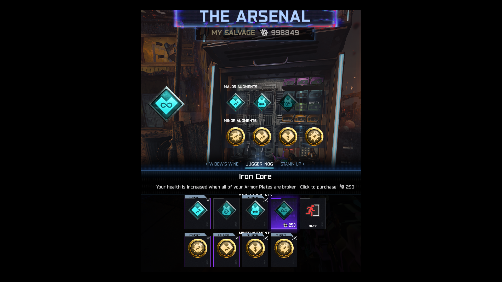

# BO7 Recrudescence

A Zombies overhaul for **Call of Duty: Black Ops 7 on Kronos**, created by [Liam McCormack](https://github.com/Liam-McCormack-Github).

## Features

### Expanded Arsenal

- Ammo Mods, Attachments, Augments and Camos in one Arsenal menu.
- Edit the weapon you are holding across nine attachment categories: Optic, Muzzle, Barrel, Underbarrel, Magazine, Rear Grip, Stock, Laser and Fire Mods, where supported by the weapon.
- Attachment changes cost **10 salvage**. Click an equipped attachment to remove it free.
- Attachment bonuses and drawbacks, equipped indicators, compatibility locks and conversion-kit rules.
- Weapon edits preserve Pack-a-Punch, rarity, ammo mods and other weapon metadata.
- Purchase major augments for **250 salvage** and minor augments for **100 salvage**. Removal and re-equipping owned augments are free for that run.
- Up to **four major and four minor augments** for each perk, field upgrade and ammo mod, subject to compatibility rules. Major/minor choices share a page, with previous/next navigation between items.
- **2,412 camo entries** across BO7, BO6, MW3 and MW2, with separate Pack-a-Punch and Mastery collections. Camo changes and removal are free.
- Expanded multi-row menus with up to 15 columns and 74 camo choices per page.

### Mystery Box

- A fixed **72-weapon pool**, including firearms, melee weapons, wonder weapons and map exclusives.
- Each player has a separate randomized rotation: a weapon does not repeat until the full pool has been rolled.
- Ordinary weapon rarity follows round progression instead of inheriting an exclusive weapon's fixed high rarity.
- Ultra rarity enters the ordinary-weapon roll from round 36 and has a 75% chance from round 50 onward. Wonder weapons retain their native rarity handling.

### Progression and balance

- **Pack-a-Punch IV** for 50,000 essence.
- Weapon rarity upgrades are no longer purchased at the Arsenal. Use **Aether Tools from Easter egg rewards** to upgrade rarity.
- **Tier IV Golden Armor** for 30,000 essence; players start without armor.
- Normal and armored zombie health caps at **25,000**; special enemies retain their native handling.
- Normal/armored zombie swipes deal **50 base damage**, before armor/perk reductions.
- Reduced zombie melee reach, capped movement speed and no super sprinters.
- Up to **70 simultaneous zombies**, with faster solo spawning and round totals based on the actual player count.
- Whitelisted common-rarity firearms have a **0.4x extra damage scalar**; upgraded weapons use their native rarity multipliers. Grenade/PhD weapon references are excluded.
- Classic-style points for damaging zombies and hit-location-based kill rewards, including headshot and melee bonuses.
- Ammo caches are disabled.
- Completing the main Easter egg awards **two Golden Mr. Peeks eggs per player**.
- Starting loadout attachments are retained.

## Installation

Install **bo7_recrudescence** through the Kronos Workshop once its catalogue submission is accepted, then enable it in the Mods menu.

For manual installation, download the ZIP from [Releases](https://github.com/Liam-McCormack-Github/bo7_recrudescence/releases), extract the `bo7_recrudescence` folder into `cod25/kronos/mods/`, and enable it. Restart the game after installing or switching builds so Lua hooks are loaded cleanly.

The public download is the production build: no Recrud console logging, dedicated debug probes or manual test commands. It does not disable Kronos's own logging or alter other mods.

Disable older `recrud`/`dev_recrud` copies before enabling this release. Other gameplay overhauls that replace the same health, damage, points or Arsenal systems can conflict; they are not required by this mod.

## Package layout

- `mod.json`: Workshop/Mods metadata.
- `scripts/`: production GSC source; Kronos compiles it when loading.
- `lua/`: production post-load menu/HUD scripts.
All icons and materials are provided by BO7; no stock image exports are bundled.

No compiled GSC files, developer build, logs, local player data or external mod-menu files are included.

## Credits

Created by [Liam McCormack](https://github.com/Liam-McCormack-Github). Thanks to Kronos and its modding community. Research references included FuzMenu, BO3 Health and Cursed Reimagined; FuzMenu is not modified or bundled.
